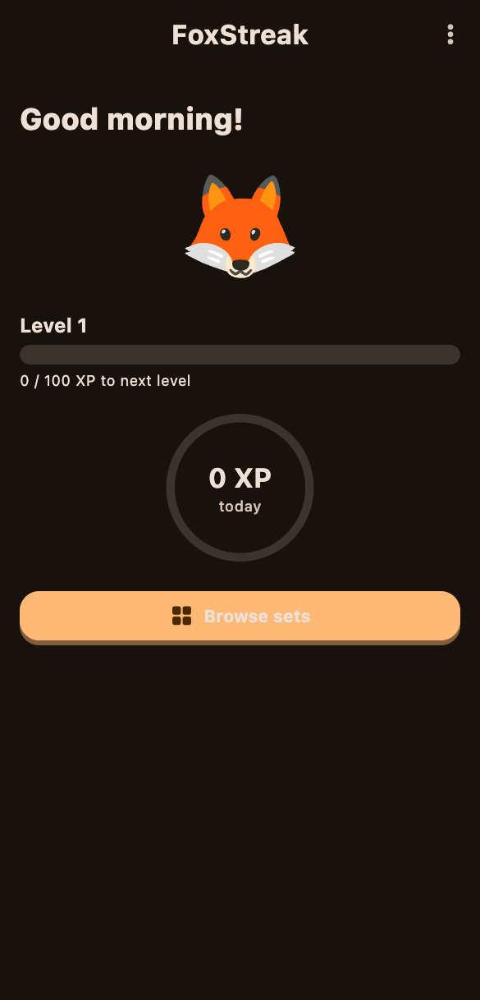

# Issue 124: Remove "Continue practicing" from Home

Status: done | Priority: P2 | Type: change | Refined-at: 2026-11-08 | Completed-at: 2026-11-08

## Goal

Home currently offers two buttons: a primary **Continue practicing**, which
jumps straight into the last-practiced set, and a secondary **Browse sets**.
The learner should always land on the set overview first and pick the set
themselves. "Continue practicing" goes away; "Browse sets" becomes Home's
single primary action.

## Desired behavior

- Home shows exactly one call-to-action button: **Browse sets**
  (DE: "Sets durchsuchen"), styled as the primary button, in the position
  the primary button has today.
- The button's icon changes from the play arrow to a library/grid-style
  icon, because it no longer starts a session.
- Tapping it opens the set overview. Nothing on Home jumps directly into a
  practice session anymore.
- The "last practiced set" shortcut is dropped entirely: no badge, sorting
  or highlight for the last-practiced set in the set overview.
- Same behavior while Home data is still loading or has errored (no dead or
  missing button).
- Scope is the Home button only. Other entry points (Android widget #115,
  result screens, streak nudges) are unchanged.
- Unchanged: greeting, streak badge, level progress, goal ring, and the
  existing data in the database (no migration).

## Acceptance criteria

- [ ] Home no longer shows "Continue practicing" / "Weiter üben" in any
      state (new learner, returning learner, loading, error).
- [ ] Home shows a single primary "Browse sets" button with the new icon
      that opens the set overview; its widget key stays
      `homeBrowseSetsButton`.
- [ ] No leftover spacing gap or secondary-styled orphan where the second
      button used to be (check light/dark, large font, 360dp).
- [ ] Dead code is removed: the continue handler on Home,
      `lastPracticedSetIdProvider` (only Home uses it), and the
      `homeContinueButton` strings in the EN and DE arb files plus the
      regenerated localizations.
- [ ] Existing tests that tap `homeContinueButton` (unit tests in
      `test/home/home_screen_test.dart`, integration tests such as
      #062, #067, #073, #078, #085, #087 and `home_screen_test`) are
      migrated to open a set via Browse sets / the shared helper in
      `integration_test/helpers.dart`.
- [ ] New or updated test asserts `homeContinueButton` is absent and
      `homeBrowseSetsButton` is the only CTA, for new and returning
      learners.
- [ ] Home is not part of the kit goldens, so no baseline update is
      expected; verify `flutter test` stays green.
- [ ] Follows #015 (kit buttons, strings via arb DE + EN).

## Summary

- Home now has one primary "Browse sets" button (grid icon, key
  `homeBrowseSetsButton`); the Continue button and its strings are gone.
- Removed `lastPracticedSetIdProvider` and the then-unused
  `StatsRepository.getLastPracticedSetId` (+ its tests).
- Integration tests now start lessons via the new `startLessonFromHome`
  helper (Browse sets -> play button).

## Code review

- Stale "Home's Continue button resumes the set" comments in the migrated integration tests.
  Fixed: reworded to Browse sets.
- `startLessonFromHome` taps the play icon without scrolling and assumes a unique title.
  Fixed (partly): added `ensureVisible`; duplicate titles are not used by any caller, so left as is.
- Open #043 (Continue/Browse duplicate on fresh install) is now obsolete.
  Not fixed: left for the backlog owner to close; out of scope here.
- Returning-learner integration test only asserts Continue is absent.
  Not fixed: it still asserts the Home screen after the lesson and the unit test covers the single CTA.
